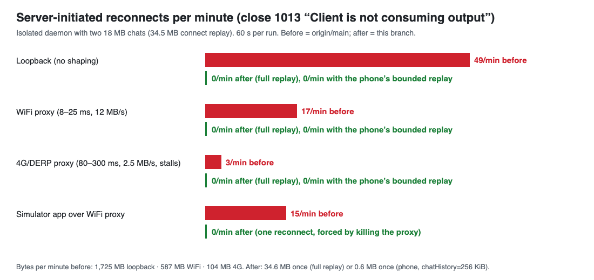

# Companion app reconnect loop and lost keyboard: evidence

## On the real setup (read-only sampling of the user's daemon, pid 26015)

`lsof` and `nettop` on the live daemon while the phone (100.77.248.62) was connected:

- About every 4 s the phone opens a new TCP connection to :4310. Each one lives about 3–4 s and carries one ~408-byte request in, then **33.3–35.7 MB out**. Peak `bytes_out` sampled every 0.25 s for three consecutive connections: 54320 → 35.7 MB, 54323 → 34.3 MB, 54324 → 33.3 MB.
- A second, long-lived connection (62845) carries the HTTP polls: git summary every 15 s, plus PRs and images. It is replaced only when Node's 5 s keep-alive timeout closes it while idle. That is harmless.

33–36 MB is the size of the daemon's connect replay to `/ws` (snapshot, briefs and, above all, `chat_snapshot` with every chat's full history). It is just over the old 32 MiB cap in `send()` (`server/index.ts`): once the replay is queued, `bufferedAmount > 32 MiB`, so the next broadcast closes the socket with 1013 "Client is not consuming output". The client still receives everything queued before the close frame (which is why each connection gets ~34 MB), then reconnects after 500 ms because its backoff reset on open. Over WiFi, 34 MB at ~10 MB/s plus 0.5 s gives exactly the ~4 s cycle.

## Reproduction (isolated daemon on :4422, own tmux socket and HOME, two fake 18 MB chats)

A small probe connects the way the app does (it reconnects 500 ms after a close), and a Node TCP proxy shapes the link and applies TCP-like backpressure (a 512 KB window):

- WiFi proxy: 8–25 ms RTT, 12 MB/s.
- 4G/DERP proxy: 80–300 ms RTT with jitter, 2.5 MB/s, 0.5% loss modelled as a 200–600 ms retransmit, and a 1–3 s stall every ~20 s.

| link | build | reconnects / 60 s | close codes | MB received / 60 s |
|---|---|---|---|---|
| loopback | before (origin/main) | **49** | 49 × 1013 | 1,725 |
| WiFi proxy | before | **17** | 17 × 1013 | 587 |
| 4G/DERP proxy | before | **3** (each ~17 s) | 3 × 1013 | 104 |
| loopback | after, full replay (desktop / old app) | 0 | none | 34.6 once |
| WiFi proxy | after, full replay | 0 | none | 34.6 once |
| 4G/DERP proxy | after, full replay | 0 | none | 34.6 once |
| loopback | after, phone (`chatHistory=262144`) | 0 | none | 0.6 once |
| WiFi proxy | after, phone | 0 | none | 0.6 once |
| 4G/DERP proxy | after, phone | 0 | none | 0.6 once |

Simulator app (iPhone 17 Pro, iOS 26.5) through the WiFi proxy:

- **Before** (origin/main app and daemon): 15 `/ws` reconnects in the minute from 16:37:31, each socket living ~3.1 s.
- **After:** a single `/ws` connection stayed up from 16:41:31 until the end of observation (16:45+). The only other connections were the 15 s HTTP polls.

A genuinely stuck client is still dropped. A client that opens `/ws` and never reads again was removed after ~60–65 s (30 s without drain progress, then ws's 30 s close-handshake timeout).

## Keyboard and draft through a reconnect (screenshots)

- `02-before-reconnect-at-17-38-25-dismissed-keyboard.png`: the socket was closed by the daemon at 16:38:24.92Z; half a second later the keyboard is gone.
- `03-before-typed-sentence-lost-after-Hal.png`: typing "Half a thought about the" kept only "Hal". The field went read-only mid-word.
- `05-after-forced-reconnect-0.3s-keyboard-and-draft-kept.png`: 0.3 s after killing the proxy connection. The keyboard and draft stay and only Send greys out; it reconnected 0.5 s later.
- `07-after-daemon-down-banner-keyboard-kept-still-typing.png`: daemon stopped for 8 s. After the 2 s grace the amber "Reconnecting…" banner shows, the keyboard is still up, and typing still lands ("… while offline").
